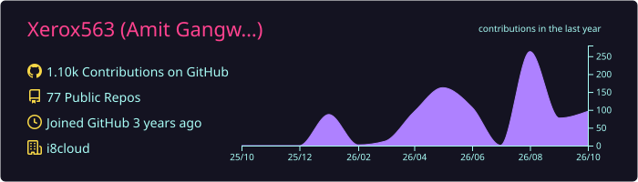
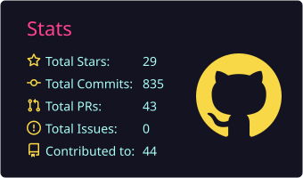
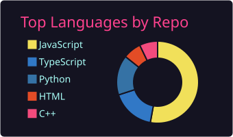
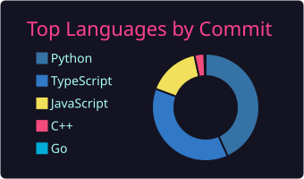
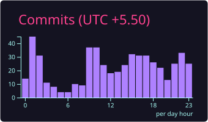
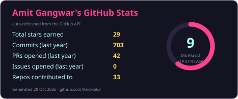
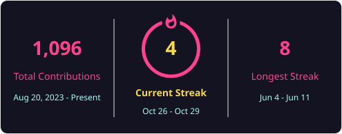

  
  

  <a href="https://portfolio-of-amit.vercel.app/">Portfolio</a> ·
  <a href="https://github.com/Xerox563">GitHub</a> ·
  <a href="https://linkedin.com/in/amit-g-a63174250">LinkedIn</a> ·
  <a href="mailto:gangwaramit449@gmail.com">Email</a>

<!-- STATS:START -->

  <code>902 contributions</code> · <code>703 commits</code> 
  <code>15 upstream PRs</code> · <code>9 merged</code> · <code>9 repos</code>

<!-- STATS:END -->

## 01 / ABOUT

I am a software engineer at **i8CLOUD**, building AI systems, backend platforms, and developer tools. I like the unglamorous parts: idempotent pipelines, merge semantics, retries, and the moment a fix lands upstream.

**Now:** shipping agentic AI and Odoo integrations at i8CLOUD, contributing upstream in Rust, TypeScript, C++, and Go, and going deeper into distributed systems.

## 02 / OPEN SOURCE

  

Open source is where the code has to survive someone else's review. I contribute to the tools I use: Rust merge semantics, Recharts visualization, Gazebo namespaces, and Go infrastructure.

<!-- OSS:START -->

  <strong>15</strong> upstream pull requests across <strong>9</strong> repositories. 
  <strong>9</strong> merged · <strong>6</strong> in review.

<!-- OSS:END -->

### Featured upstream work

#### [keepass-rs](https://github.com/sseemayer/keepass-rs) · `RUST` · `IN REVIEW`

**Ancestor-aware three-way merge for KDBX databases**

Designed the merge from first principles: one-sided changes apply even when their timestamps are older, true conflicts warn, and additions, deletions, moves, entry history, and custom icons are covered. Added 13 regression tests.

[Read PR #390 →](https://github.com/sseemayer/keepass-rs/pull/390)

#### [Recharts](https://github.com/recharts/recharts) · `TYPESCRIPT` · `MERGED + IN REVIEW`

**Nightingale and Wind Rose chart examples**

Merged the Nightingale example. The Wind Rose example ships with nine visual-regression baselines across Chromium, Firefox, WebKit, light and dark themes, plus a three-series legend and corrected compass labels.

[PR #8095 →](https://github.com/recharts/recharts/pull/8095) · [PR #8118 →](https://github.com/recharts/recharts/pull/8118)

#### [Gazebo Sim](https://github.com/gazebosim/gz-sim) · `C++` · `5 MERGED + 1 IN REVIEW`

**Namespace support across six simulation systems**

CameraVideoRecorder, PosePublisher, DetachableJoint, FreeSpaceExplorer, PerformerDetector, and KineticEnergyMonitor.

[PR #4124 →](https://github.com/gazebosim/gz-sim/pull/4124) · [Merged PRs →](https://github.com/pulls?q=is%3Apr+author%3AXerox563+is%3Amerged+repo%3Agazebosim%2Fgz-sim)

ALSO MERGED [ceph-csi #6677](https://github.com/ceph/ceph-csi/pull/6677) · [ORAS #2271](https://github.com/oras-project/oras/pull/2271) · [LangChain docs #7017](https://github.com/langchain-ai/docs/pull/7017)

IN REVIEW [APITable #1823](https://github.com/apitable/apitable/pull/1823) · [StyleX #1997](https://github.com/meta/stylex/pull/1997) · [RocketRide #2818](https://github.com/rocketride-org/rocketride-server/pull/2818)

<strong>Full upstream merge log</strong>

<!-- OSS_LOG:START -->
| Repository | Pull request | Status |
|---|---|---|
| [sseemayer/keepass-rs](https://github.com/sseemayer/keepass-rs) | [#390: feat(merge): add ancestor-aware three-way merge](https://github.com/sseemayer/keepass-rs/pull/390) | in review |
| [recharts/recharts](https://github.com/recharts/recharts) | [#8118: docs(www): add multi-series wind rose example](https://github.com/recharts/recharts/pull/8118) | in review |
| [recharts/recharts](https://github.com/recharts/recharts) | [#8095: docs(www): add Nightingale chart example](https://github.com/recharts/recharts/pull/8095) | merged 2026-10-28 |
| [rocketride-org/rocketride-server](https://github.com/rocketride-org/rocketride-server) | [#2818: feat(nodes): add store_lancedb, an embedded LanceDB vector store](https://github.com/rocketride-org/rocketride-server/pull/2818) | in review |
| [meta/stylex](https://github.com/meta/stylex) | [#1997: [babel-plugin] Polyfill logical border radius properties](https://github.com/meta/stylex/pull/1997) | in review |
| [gazebosim/gz-sim](https://github.com/gazebosim/gz-sim) | [#4127: Add namespace support to KineticEnergyMonitor](https://github.com/gazebosim/gz-sim/pull/4127) | merged 2026-10-27 |
| [apitable/apitable](https://github.com/apitable/apitable) | [#1823: feat: add theme toggle to space management](https://github.com/apitable/apitable/pull/1823) | in review |
| [gazebosim/gz-sim](https://github.com/gazebosim/gz-sim) | [#4124: Add namespace support to CameraVideoRecorder](https://github.com/gazebosim/gz-sim/pull/4124) | in review |
| [gazebosim/gz-sim](https://github.com/gazebosim/gz-sim) | [#4126: Add namespace support to PerformerDetector](https://github.com/gazebosim/gz-sim/pull/4126) | merged 2026-10-27 |
| [gazebosim/gz-sim](https://github.com/gazebosim/gz-sim) | [#4121: Add namespace support to PosePublisher](https://github.com/gazebosim/gz-sim/pull/4121) | merged 2026-10-27 |
| [ceph/ceph-csi](https://github.com/ceph/ceph-csi) | [#6677: util: add --config flag for the Ceph-CSI config file path](https://github.com/ceph/ceph-csi/pull/6677) | merged 2026-10-26 |
| [gazebosim/gz-sim](https://github.com/gazebosim/gz-sim) | [#4125: Add namespace support to FreeSpaceExplorer](https://github.com/gazebosim/gz-sim/pull/4125) | merged 2026-10-26 |
| [gazebosim/gz-sim](https://github.com/gazebosim/gz-sim) | [#4123: Add namespace support to DetachableJoint](https://github.com/gazebosim/gz-sim/pull/4123) | merged 2026-10-26 |
| [oras-project/oras](https://github.com/oras-project/oras) | [#2271: ci: publish build provenance attestations for release artifacts](https://github.com/oras-project/oras/pull/2271) | merged 2026-10-23 |
| [langchain-ai/docs](https://github.com/langchain-ai/docs) | [#7017: [FIX] fixed BaseMessage import in functional API chatbot example](https://github.com/langchain-ai/docs/pull/7017) | merged 2026-10-23 |
<!-- OSS_LOG:END -->

[All pull requests →](https://github.com/pulls?q=is%3Apr+author%3AXerox563)

## 03 / SELECTED WORK

### [MindVault](https://mindvault7.vercel.app/) · RAG knowledge platform

`SOURCES → INGEST → EMBED → HYBRID RETRIEVE → CITED ANSWERS`

Upload PDFs, DOCX, XLSX, or sync Google Drive, Sheets, Slack, and Notion. Hybrid BM25 plus Chroma retrieval, source-cited answers, Redis rate limits, and switchable LLM backends.

[Live](https://mindvault7.vercel.app/) · [Code](https://github.com/Xerox563/MindVault)

### [Luminal](https://luminal-six.vercel.app/) · LLM routing gateway

`PROMPT → ANALYZE → RETRIEVE/TOOLS → ROUTE → GENERATE → CRITIC`

A LangGraph routing engine that sends simple prompts to cheaper models across eight providers, retries when the critic scores an answer low, and tracks spend against budget thresholds.

[Live](https://luminal-six.vercel.app/) · [Code](https://github.com/Xerox563/Luminal)

### [Notification System](https://github.com/Xerox563/Notification-system) · Async delivery service

`API → PRIORITY QUEUES → WORKERS → PROVIDERS → RETRY/DLQ`

FastAPI, Postgres, Redis, and Prometheus. Per-channel workers, exponential backoff, idempotency keys, a circuit breaker with provider fallback, and 4,000+ requests accepted under load with zero errors.

[Code](https://github.com/Xerox563/Notification-system)

## 04 / TOOLBOX

- **AI systems:** LangChain · LangGraph · CrewAI · RAG · pgvector · ChromaDB · MCP · n8n
- **Backend:** Python · FastAPI · Node.js · Express · RabbitMQ · Celery · WebSockets
- **Frontend:** React · Next.js · TypeScript · Tailwind · Redux · Three.js
- **Data and infra:** PostgreSQL · MongoDB · Redis · Docker · AWS · CI/CD · Linux
- **Languages:** Python · TypeScript · JavaScript · Rust · C++ · Go · Java · SQL

## 05 / EXPERIENCE

**i8CLOUD** · Software Developer · Jul 2025 - Present

- Built a LightSpeed to Odoo integration syncing products, inventory, and pricing across 10+ stores through AWS event-driven and scheduled pipelines.
- Deployed an MCP-integrated leave management system for 200+ employees, with automated end-of-month balance notifications.
- Created an OCR document pipeline that cut manual receipt, POS, and invoice entry time by 30%.
- Shipped a production RAG pipeline over 1,000+ candidate profiles and integrated Claude with Odoo to cut recruitment cycle time by 40%.

**WittyHat** · Software Developer Intern · May 2025 - Jun 2025

- Built Python backend services for YouTube automation with Celery workers, Google OAuth, and event-driven pipelines.
- Cut page load time from 3.2s to 2.2s with lazy loading, caching, and MongoDB indexing.

## 06 / SIGNALS

| 1,600+ | 1654 | 1872 | 8.01 | Winner | 3x |
|:---:|:---:|:---:|:---:|:---:|:---:|
| DSA problems | Codeforces Expert | LeetCode Knight | CGPA | i8CLOUD Hackathon | Pat on the Back |

B.Tech in Information Technology, Bundelkhand Institute of Engineering and Technology, Jhansi · 2021 - 2025

## 07 / GITHUB STATS

   <strong>GITHUB STATS</strong> 
  Live profile telemetry, refreshed weekly by GitHub Actions.

  
  

  
  
  

  
  

## 08 / CONTACT

<strong>Building something in AI infrastructure, developer tools, or open source? Let's build something worth merging.</strong>

  <a href="https://portfolio-of-amit.vercel.app/">Portfolio</a> ·
  <a href="https://github.com/Xerox563">GitHub</a> ·
  <a href="https://linkedin.com/in/amit-g-a63174250">LinkedIn</a> ·
  <a href="mailto:gangwaramit449@gmail.com">Email</a>

<!-- UPDATED:START -->

Stats refreshed 29 Oct 2026 by GitHub Actions.

<!-- UPDATED:END -->
